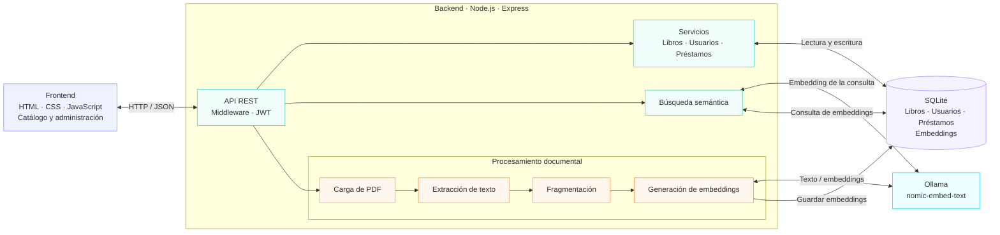

# BiblioFCA — Catálogo público y administración de biblioteca

Proyecto integrador full-stack: catálogo público, gestión administrativa de lectores y préstamos, carga de PDFs, y **búsqueda por contenido semántico** integrada en la misma barra de búsqueda, usando una base de datos vectorial propia y **nomic-embed-text** (vía Ollama).

**Stack:** Node.js + Express (API REST) · SQLite (`better-sqlite3`) · JWT + bcrypt (login) · `multer` + `pdf-parse` (carga y lectura de PDFs) · HTML/CSS/JavaScript puro (frontend) · Ollama + nomic-embed-text (embeddings y base de datos vectorial).

---

## 1. Instalación y ejecución

Instala [Ollama](https://ollama.com/download) en Windows (o con WinGet):
```powershell
winget install --exact --id Ollama.Ollama --source winget
```

Abre Ollama desde el menú Inicio y descarga el modelo de embeddings:
```powershell
ollama pull nomic-embed-text
```

Ollama debe estar ejecutándose en `http://localhost:11434` para indexar libros y realizar búsquedas semánticas.

```bash
npm install
```

Configura la clave JWT y las credenciales del primer administrador en la misma terminal. En PowerShell:
```powershell
$env:JWT_SECRET = [Convert]::ToBase64String([byte[]](1..48 | ForEach-Object { Get-Random -Maximum 256 }))
$env:ADMIN_NOMBRE = "Administración de Biblioteca"
$env:ADMIN_CORREO = "admin@biblioteca.edu"
$env:ADMIN_PASSWORD = "usa-una-clave-segura-de-12-caracteres"
npm run seed
npm start
```

Abre `http://localhost:3000`. El catálogo y la búsqueda son públicos. El botón **Acceso administrador** abre el login de las cuentas administrativas provisionadas con `npm run seed`. El registro público está deshabilitado. En bases de datos existentes, las cuentas previas no conservan permisos automáticamente: aprovisiona explícitamente las cuentas autorizadas con el seed. Conserva el mismo `JWT_SECRET` en cada reinicio del servidor y entre sus instancias; cambiarlo invalida las sesiones activas.

### Pruebas de interfaz

Desde la raíz del proyecto, instala las dependencias de pruebas y ejecuta Playwright:

```bash
npm install
npx playwright install chromium
npm test
```

La suite inicia el backend automáticamente y simula las respuestas del catálogo y del inicio de sesión para que las pruebas no dependan del contenido de la base de datos.

Para dar de alta o actualizar cuentas administrativas, vuelve a ejecutar `npm run seed` desde la raíz con `ADMIN_NOMBRE`, `ADMIN_CORREO` y `ADMIN_PASSWORD` configurados para esa cuenta. Las contraseñas deben tener al menos 12 caracteres. Configura `JWT_SECRET` antes de iniciar el servidor; debe tener al menos 32 caracteres y mantenerse privado.

Si tienes Ollama corriendo, después del seed puedes generar los embeddings de los libros de ejemplo:
```bash
npm run indexar
```

## 2. Módulos

- **Login administrativo** con JWT (1h) y contraseñas cifradas con bcrypt. El registro público está deshabilitado.
- **Catálogo público**: estudiantes pueden consultar y buscar libros sin iniciar sesión.
- **Permisos**: solo cuentas con rol de administrador pueden cargar, editar o eliminar libros, y gestionar préstamos, lectores y el panel.
- **Catálogo**: crear, editar, eliminar, buscar y filtrar libros por categoría/disponibilidad. Cada libro puede tener un **PDF adjunto**.
- **Préstamos**: registrar y devolver préstamos, con control de ejemplares disponibles, vencimiento a 14 días, y detección de atrasados.
- **Lectores**: registro de usuarios que piden prestado.
- **Panel**: estadísticas generales de la biblioteca.
- **Búsqueda por contenido (IA)**: ver sección siguiente.

## 3. Cómo funciona la búsqueda vectorial

Cuando añades o editas un libro (con o sin PDF), el sistema automáticamente:
1. Toma su título, autor, sinopsis, y el texto extraído del PDF (si tiene uno).
2. Lo divide en fragmentos (~900 caracteres, con solape) y genera un **embedding** (vector numérico) por fragmento con nomic-embed-text vía Ollama.
3. Guarda esos vectores en la tabla `embeddings_libros` — esa tabla ES la base de datos vectorial. Todo esto corre **en segundo plano** al guardar el libro, sin bloquear la respuesta al bibliotecario.

Cuando alguien busca algo en la barra de búsqueda normal del catálogo, además de los resultados exactos (por título/autor/ISBN, como siempre), el sistema:
1. Convierte la búsqueda en un vector de la misma forma.
2. Compara ese vector contra todos los fragmentos guardados (similitud de coseno).
3. Si encuentra libros relevantes que no aparecieron ya en los resultados exactos, los muestra debajo como **"Quizás te interese (sugerido por el contenido)"** — integrado en la misma pantalla, sin ningún panel aparte.
4. **Si no hay nada relevante, o Ollama no responde, esa sección simplemente no aparece.** Nunca se rompe la búsqueda normal ni se muestra un error al bibliotecario.

Puedes re-generar los embeddings de todos los libros en cualquier momento con:
```bash
npm run indexar
```
Esto es útil si Ollama estuvo apagado mientras se cargaban libros, o si cambias de modelo de embeddings.

### Configuración (opcional, variables de entorno)
```bash
export OLLAMA_URL="http://localhost:11434"
export OLLAMA_MODEL="nomic-embed-text"     # modelo usado para los embeddings
export OLLAMA_UMBRAL_SIMILITUD="0.5"       # qué tan parecido debe ser algo para sugerirse (0 a 1)
```

> Si ya habías generado embeddings con otro modelo, vuelve a generarlos con `npm run indexar` después de cambiarlo. Los vectores de modelos distintos no se deben mezclar.

## 4. Carga de PDFs

Al añadir o editar un libro puedes adjuntar un PDF (máx. 20 MB). Se guarda en `backend/uploads/pdfs/` con un nombre generado por el servidor (no el original). Cada libro con PDF muestra un botón **"📄 Ver PDF"** en el catálogo público, que lo abre en una pestaña nueva sin necesidad de iniciar sesión.

Si reemplazas o eliminas un libro con PDF, el archivo viejo se borra solo del servidor.

## 5. Estructura del proyecto

```
biblioteca-virtual/
├── backend/
│   ├── database/
│   │   ├── schema.sql       # incluye la tabla embeddings_libros (vectorial)
│   │   ├── db.js             # conexión + migraciones automáticas
│   │   ├── seed.js           # datos de ejemplo
│   │   └── indexar.js        # script para (re)generar embeddings en lote
│   ├── middleware/auth.js    # verificación de JWT
│   ├── services/vectores.js  # toda la lógica de embeddings y similitud
│   ├── routes/
│   │   ├── auth.js
│   │   ├── libros.js         # incluye subida de PDF y búsqueda + sugerencias
│   │   ├── usuarios.js
│   │   ├── prestamos.js
│   │   └── categorias.js
│   └── server.js
└── frontend/
    ├── index.html
    ├── css/style.css
    └── js/app.js
```

## 6. Endpoints principales

| Método | Ruta | Descripción |
|---|---|---|
| POST | `/api/auth/login`, `/api/auth/registro` | Autenticación (públicas) |
| GET | `/api/libros?q=...&categoria=...&disponibles=true` | Catálogo público. Devuelve `{ resultados, sugerencias }` |
| GET | `/api/categorias` | Categorías públicas para filtrar el catálogo |
| POST | `/api/libros` | Crear libro (multipart/form-data, PDF opcional en el campo `pdf`; requiere administrador) |
| PUT | `/api/libros/:id` | Editar libro (PDF opcional, reemplaza el anterior; requiere administrador) |
| GET | `/api/libros/:id/pdf` | Ver el PDF adjunto (público) |
| DELETE | `/api/libros/:id` | Eliminar libro (borra también su PDF y sus embeddings; requiere administrador) |
| GET/POST | `/api/usuarios`, `/api/prestamos` | Módulos de administración (requieren administrador) |
| GET | `/api/categorias` | Categorías públicas |
| POST | `/api/categorias` | Crear categoría (requiere administrador) |
